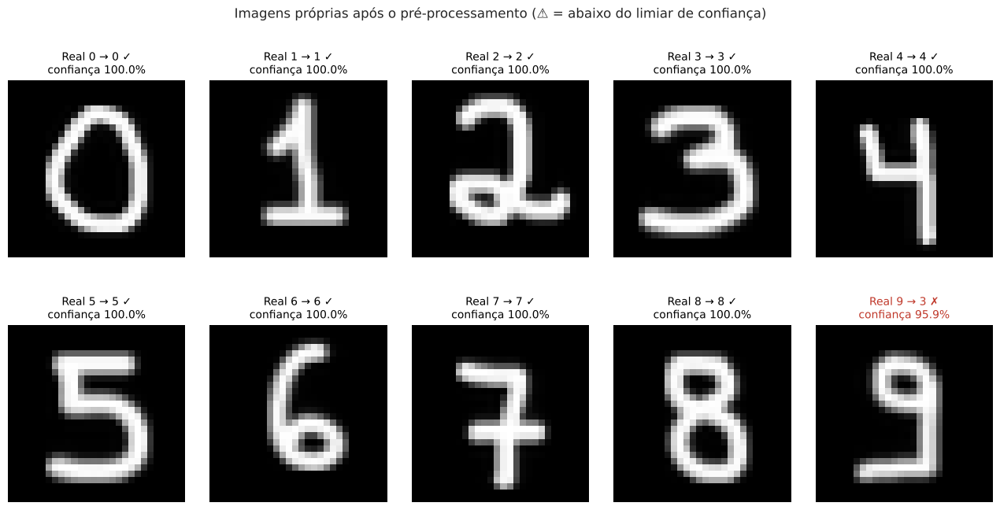

# Digit Classifier API

API para reconhecer dígitos escritos à mão (0 a 9). A ideia é que qualquer sistema, como um leitor de formulários, possa enviar uma imagem e receber o número de volta, sem precisar rodar o modelo por conta própria.

Projeto Avaliativo do Módulo 2.

## Origem do modelo

O modelo vem do meu mini-projeto [multiclass-predictive-pipeline](https://github.com/eduardaecher/multiclass-predictive-pipeline) (Módulo 2, Semana 6). Nele comparei KNN, Random Forest e uma rede neural MLP no dataset MNIST, e a MLP teve o melhor resultado: 97,36% de acurácia no teste.

Para este projeto, retreinei a mesma rede (784 → 128 → 64 → 10) com a mesma base e a mesma divisão dos dados. As mudanças foram pensadas para usar o modelo numa API:

- troquei o Keras pelo `MLPClassifier` do scikit-learn e coloquei o scaler e a rede num único pipeline, salvo em `models/digit_mlp_pipeline.joblib` (2,3 MB);
- usei early stopping;
- adicionei um limiar de confiança: abaixo de 0,90 a API avisa que a previsão não é confiável;
- o pré-processamento das imagens agora inverte as cores sozinho e centraliza o dígito pelo centro de massa.

Todo o treino está em `treinamento_modelo.ipynb`.

## Resultados

No conjunto de teste (14.000 imagens), o modelo teve 97,75% de acurácia, F1 macro de 0,977 e ROC-AUC de 0,9994. O erro mais comum é confundir 4 com 9.

Com os 10 dígitos que desenhei à mão (`data/imagens_proprias`), acertou 9. O 9 continua sendo lido como 3, como no projeto anterior.



## Estrutura

- `app/main.py`: inicia a API e carrega o modelo uma única vez
- `app/routers/`: as rotas
- `app/schemas/`: formato dos dados de entrada e saída (Pydantic)
- `app/services/`: carregamento do modelo e previsão
- `app/ml/preprocessing.py`: conversão de imagens para o formato do MNIST
- `app/core/`: configurações e tratamento de erros
- `models/`: modelo treinado e métricas
- `tests/`: testes automatizados

## Tecnologias

Python 3.11+, FastAPI 0.162, Uvicorn 0.54, Pydantic 2.13, scikit-learn 1.9, NumPy, SciPy, Pillow, joblib e pytest. As versões completas estão no `requirements.txt`.

## Como executar

```bash
python -m venv .venv
.venv\Scripts\activate        # no Linux/Mac: source .venv/bin/activate
pip install -r requirements.txt
uvicorn app.main:app --reload
```

Depois acesse a documentação em http://127.0.0.1:8000/docs, onde dá para testar todas as rotas.

Para rodar os testes: `pytest`.

O modelo já vem treinado. Para treinar de novo, basta rodar o notebook (na primeira vez ele baixa o MNIST, o que pode demorar alguns minutos).

## Rotas

- `GET /health`: diz se a API está no ar e se o modelo está carregado
- `POST /v1/predict`: recebe os 784 pixels da imagem em JSON
- `POST /v1/predict/imagem`: recebe um arquivo de imagem (PNG, JPG ou BMP)
- `GET /v1/model/info`: mostra a versão e as métricas do modelo

### Exemplo com pixels

O corpo tem uma lista com os 784 valores (0 a 255) da imagem 28x28, linha por linha, com fundo preto. O exemplo completo está em `examples/digito_7.json`.

```bash
curl -X POST http://127.0.0.1:8000/v1/predict -H "Content-Type: application/json" -d @examples/digito_7.json
```

Resposta:

```json
{
  "digito_previsto": 7,
  "confianca": 1.0,
  "previsao_confiavel": true,
  "limiar_confianca": 0.9,
  "top_3": [
    {"digito": 7, "probabilidade": 1.0},
    {"digito": 3, "probabilidade": 0.0},
    {"digito": 2, "probabilidade": 0.0}
  ],
  "probabilidades": [0.0, 0.0, 0.0, 0.0, 0.0, 0.0, 0.0, 1.0, 0.0, 0.0],
  "versao_modelo": "1.0.0"
}
```

Para gerar esse JSON a partir de qualquer imagem: `python scripts/imagem_para_json.py caminho/da/imagem.png`.

### Exemplo com imagem

```bash
curl -X POST http://127.0.0.1:8000/v1/predict/imagem -F "arquivo=@data/imagens_proprias/digito_5.png"
```

### Erros

- 422: dados fora do formato, como uma lista sem 784 itens, um pixel acima de 255 ou texto no lugar de número (exemplo em `examples/pixels_invalidos_422.json`)
- 400: JSON malformado, imagem em branco, cores invertidas ou arquivo que não é imagem (exemplos em `examples/imagem_vazia_400.json` e `examples/cores_invertidas_400.json`)
- 413: arquivo maior que 2 MB
- 503: modelo não carregado
- 500: erro inesperado na previsão

Exemplo de resposta 422:

```json
{
  "erro": "dados_invalidos",
  "mensagem": "Um ou mais campos não atendem ao contrato de entrada.",
  "detalhes": [
    {"campo": "pixels.0", "mensagem": "Input should be less than or equal to 255", "valor_recebido": 300, "tipo": "less_than_equal"}
  ]
}
```

## Branches

Usei `main` para a versão final, `develop` para integrar e uma branch `feature/` para cada etapa: estrutura do projeto, pré-processamento de imagens, treinamento do modelo, configuração e erros, schemas, services, routers, main com lifespan, testes e documentação.

## O que pode melhorar

- Usar uma rede convolucional (CNN), que costuma errar menos em casos como 4 e 9.
- Treinar também com dígitos desenhados no computador, para generalizar melhor.
- Recusar imagens que não são dígitos, em vez de classificá-las com falsa certeza.
- Adicionar Docker e rodar os testes automaticamente no GitHub.
